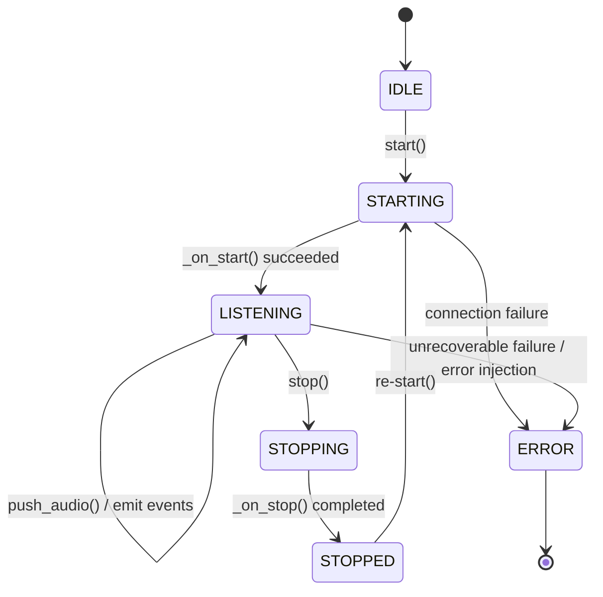

# Provider-Neutral STT Adapter & Deterministic Fake Transcriber

This document details the architecture, interfaces, and deterministic guarantees of the **Speech-to-Text (STT) Adapter Engine** built for **Academia – AI Voice Co-Pilot**.

---

## 1. Architectural Motivation

In the Academia voice assistant, the speech pipeline must interact seamlessly with diverse STT backends:
- **Cloud STT Providers**: Deepgram Nova-2, Whisper API, Google Cloud Speech-to-Text v2, Azure Speech Service.
- **Local/On-Prem Models**: Local Whisper (faster-whisper), Vosk, Silero VAD.
- **Deterministic Test Doubles**: `FakeTranscriber` for regression testing, frontend UI development, CI/CD pipelines, and agent reasoning integration without burning external API credits.

To decouple backend business logic, agent orchestration, and UI rendering from specific vendor SDKs, we introduce a **Provider-Neutral Adapter Interface (`BaseTranscriber`)**.

```
                ┌───────────────────────────────────┐
                │        BaseTranscriber (ABC)      │
                │  - Lifecycle: start(), stop()     │
                │  - Audio: push_audio(), finish()  │
                │  - Stream: stream(), callbacks    │
                └─────────────────▲─────────────────┘
                                  │
         ┌────────────────────────┼────────────────────────┐
         │                        │                        │
┌────────┴─────────┐     ┌────────┴─────────┐     ┌────────┴─────────┐
│ FakeTranscriber  │     │ DeepgramAdapter  │     │ WhisperAdapter   │
│ (Deterministic)  │     │ (Cloud Live WS)  │     │ (Local/API)      │
└──────────────────┘     └──────────────────┘     └──────────────────┘
```

---

## 2. Core Components

### 2.1 Audio Configuration (`AudioConfig`)
Standardizes audio formatting across clients and recognition engines.

| Field | Type | Default | Description |
| :--- | :--- | :--- | :--- |
| `sample_rate_hertz` | `int` | `16000` | Audio sampling frequency (8kHz to 48kHz). |
| `channels` | `int` | `1` | Audio channel count (1=mono, 2=stereo). |
| `encoding` | `AudioEncoding` | `PCM_S16LE` | Audio sample format (`pcm_s16le`, `pcm_f32le`, `opus`, `mulaw`, `alaw`). |
| `chunk_duration_ms` | `int` | `100` | Preferred frame slice duration in ms. |

#### Calculated Helper Properties:
* `bytes_per_second`: `sample_rate_hertz * channels * bytes_per_sample` (e.g. $16000 \times 1 \times 2 = 32,000\text{ bytes/s}$).
* `chunk_size_bytes`: Byte count for one chunk of duration `chunk_duration_ms` ($3,200\text{ bytes}$ for 100ms at 16kHz 16-bit).
* `bytes_to_duration_ms(byte_count)`: Precise conversion between byte buffer length and audio timeline milliseconds.
* `duration_ms_to_bytes(duration_ms)`: Conversion from target duration to raw byte length.

---

### 2.2 Transcriber Lifecycle State Machine (`TranscriberState`)



* `IDLE`: Initial state upon instantiation.
* `STARTING`: Initializing network sockets or model weights.
* `LISTENING`: Actively receiving audio chunks (`push_audio`) and emitting streaming transcript events.
* `STOPPING`: Flushing pending hypotheses.
* `STOPPED`: Session terminated gracefully.
* `ERROR`: Unrecoverable error state.

---

### 2.3 Provider-Neutral Adapter Contract (`BaseTranscriber`)

Every concrete provider adapter inherits from `BaseTranscriber` and implements:
1. `_on_start() -> None`: Provider socket handshake / authentication.
2. `_on_stop() -> None`: Provider socket closure and resource cleanup.
3. `_process_audio_chunk(chunk: bytes) -> None`: Frame delivery into the STT engine.
4. `_on_finish_audio() -> None`: Signal turn boundary / final flush.

#### Public Consumption Methods:
* **Async Context Manager**: `async with transcriber:` auto-manages lifecycle.
* **Async Event Streaming**: `async for event in transcriber.stream():` yields `TranscriptEvent` instances.
* **Callback Listeners**: `transcriber.add_event_listener(callback)` supports synchronous or async event listeners.
* **Batch Transcription**: `await transcriber.transcribe_audio(audio_bytes)` processes a complete audio buffer and returns all generated events.
* **Stream Piping**: `await transcriber.transcribe_stream(audio_generator)` pipes an async chunk stream directly into the transcriber.

---

## 3. Deterministic Fake Transcriber (`FakeTranscriber`)

### 3.1 The Determinism Guarantee
> **"Same input $\rightarrow$ Identical transcript events"**

Given identical inputs (same audio bytes, script, session ID, or seed), `FakeTranscriber` guarantees that:
1. **Event Count & Types**: Identical sequence (`SPEECH_STARTED` $\rightarrow$ `INTERIM_TRANSCRIPT`* $\rightarrow$ `FINAL_TRANSCRIPT` $\rightarrow$ `SPEECH_ENDED`).
2. **Sequence Numbers**: Monotonic counter ($1, 2, 3, \dots$).
3. **Deterministic UUID5 Identifiers**:
   - `event_id` is derived deterministically:
     $$\text{UUID5}(\text{NAMESPACE\_DNS}, \text{f"voicebot:\{session\_id\}:\{event\_type\}:\{seq\}"})$$
   - Segment `id` is derived deterministically:
     $$\text{UUID5}(\text{NAMESPACE\_DNS}, \text{f"voicebot:\{session\_id\}:segment:\{idx\}"})$$
4. **Reproducible Timestamps**:
   - Instead of volatile `datetime.now(timezone.utc)`, timestamps derive from a fixed reference epoch (`2026-01-01T12:00:00Z` or user-supplied) plus the audio timeline offset in milliseconds:
     $$\text{timestamp} = t_{\text{ref}} + \Delta t_{\text{audio}}$$
5. **Sub-Segment Word Timings (`WordTiming`)**:
   - Character-weighted token slicing with deterministic confidence calculations.
6. **Bit-for-Bit JSON Serialization**:
   - `events_run1[i].model_dump_json() == events_run2[i].model_dump_json()` across independent runs, dates, and environments.

---

### 3.2 Flexible Input Modes

#### Mode 1: Pre-Scripted Scenarios
Provide explicit text or `FakeUtterance` models for predictable conversational testing:
```python
transcriber = FakeTranscriber(
    session_id="session-42",
    script=[
        "Can you explain Dijkstra's algorithm?",
        "What is the time complexity in worst case?",
    ],
)
```

#### Mode 2: Audio-Driven Deterministic Fallback
Feed raw audio bytes without configuring a script. The engine computes a cryptographic hash of the audio stream (`SHA-256`) to deterministically select phrases from an academic corpus:
```python
transcriber = FakeTranscriber(session_id="audio-session")
events = await transcriber.transcribe_audio(raw_audio_pcm)
# Repeating this with the same audio bytes returns the exact same events every time!
```

#### Mode 3: Deterministic Error Injection
Simulate unexpected provider crashes, audio pipeline underruns, or socket disconnects after a precise chunk milestone:
```python
transcriber = FakeTranscriber(
    session_id="resilience-test",
    error_after_chunks=3,
    simulated_error=TranscriptError(
        code="MICROPHONE_HARDWARE_FAULT",
        message="Simulated USB microphone disconnection.",
    ),
)
```

---

## 4. Usage Examples

### 4.1 Streaming Audio Ingestion
```python
import asyncio
from src.voice import FakeTranscriber

async def main():
    async with FakeTranscriber(session_id="user-123", script="Why is my query slow?") as stt:
        # Push 100ms audio chunks
        chunk = b"\x00" * 3200
        for _ in range(5):
            await stt.push_audio(chunk)
        await stt.finish_audio()

        for event in stt.events_history:
            print(f"[{event.event_type.value}] seq={event.sequence_number} "
                  f"text={event.segment.text if event.segment else '-'}")

asyncio.run(main())
```

### 4.2 Piping an Audio Stream
```python
async def simulate_mic_stream():
    for _ in range(10):
        yield b"\x00" * 3200

async with FakeTranscriber(session_id="mic-session") as stt:
    async for event in stt.transcribe_stream(simulate_mic_stream()):
        if event.event_type == "interim_transcript":
            print("Interim:", event.segment.text)
        elif event.event_type == "final_transcript":
            print("Final:", event.segment.text)
```
