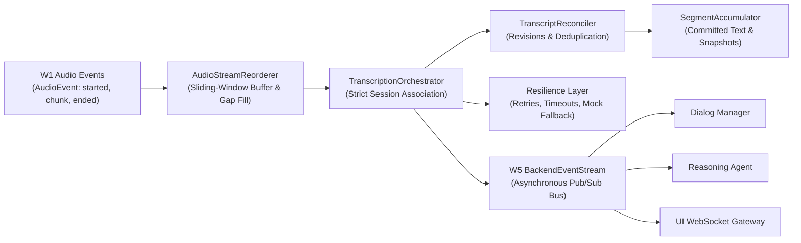

# Week 3 Integration Evidence & Day 21 Team Gate Report

**Milestone:** Week 3 (Day 21 – Integration Evidence, Pull Request & Demo)  
**Team:** SDE 2 (Voice & Speech-to-Text)  
**Project Folder:** `projects/sde-2-voicebot/` (Active workspace: `Voicebot`)  
**Feature Branch:** `sneha-balur`  
**Base Branch:** `team/sde-2-voicebot` (or `develop`)  
**Target Repository:** `https://github.com/srbalur2007-sys/Voicebot.git` (Upstream: `https://github.com/divya182307-dot/voicebot-SDE2-teamm.git`)  
**Offline Invariant:** 100% offline execution; zero external provider API keys or audio hardware required.

---

## 1. Executive Summary & Team Gate Invariants

Week 3 delivers a session-aware, fault-tolerant speech-to-text integration layer connecting upstream audio capture (`W1`) and downstream intelligence consumers (`W5`).



---

## 2. Acceptance Criteria Verification Matrix

| Acceptance Criterion | Implementation Details | Test Coverage | Status |
| :--- | :--- | :--- | :--- |
| **Interim results revised and finalized with clear events** | Consecutive interim hypotheses tracked with monotonic revision counters (`revision=1, 2...`, `is_revision=True`); final segment carries `is_finalization=True` and `total_revisions_for_segment`. | `tests/test_session_and_revisions.py`<br/>`tests/test_week3_integration.py` | **VERIFIED** |
| **Every transcript event carries its session ID** | Strict session validation via `enforce_session_id=True` across `TranscriptionOrchestrator`, `TranscriptReconciler`, and `SegmentAccumulator`. Rejects foreign events with `SessionMismatchError`. | `tests/test_session_and_revisions.py`<br/>`tests/test_event_stream_integration.py` | **VERIFIED** |
| **Low-confidence segments handled by configurable threshold** | `confidence_threshold` in `[0.0, 1.0]` with policies: `"tag"` (marks `is_low_confidence=True`), `"filter"` (drops from transcript), or `"ignore"`. | `tests/test_session_and_revisions.py` | **VERIFIED** |
| **Cancellation stops in-flight transcription cleanly** | `orchestrator.cancel()` transitions state to `CANCELLED`, drains pending audio queues, cancels background workers, stops adapters, and terminates subscriber queues with sentinels. | `tests/test_cancellation_and_fallback.py`<br/>`tests/test_week3_integration.py` | **VERIFIED** |
| **Quota or network failures fall back to mock provider** | Automatic failover to `FakeTranscriber` within the same session upon HTTP 429 quota exhaustion or connection drop. Replays failed chunk and emits normalized `TranscriptEvent(ERROR)` with `fallback_triggered=True`. Zero raw vendor exceptions leak. | `tests/test_cancellation_and_fallback.py`<br/>`tests/test_week3_integration.py` | **VERIFIED** |
| **Audio events flow into transcription and reach backend stream end-to-end** | `AudioEvent` packets ingested via `orchestrator.push_audio_event()`; reconciled events broadcast in real time to `BackendEventStream` with multiplexed subscriber queues and callback consumers. | `tests/test_event_stream_integration.py`<br/>`tests/test_week3_integration.py` | **VERIFIED** |
| **Tests cover out-of-order chunks and missing chunks** | `AudioStreamReorderer` sliding-window buffer sorts out-of-order packets and fills missing packet gaps with synthetic zero-padded silence packets (`synthetic_fill=True`). | `tests/test_event_stream_integration.py`<br/>`tests/test_week3_integration.py` | **VERIFIED** |
| **No duplicate schema definitions; no recordings or secrets committed** | Reused existing schemas in `src/voice/schemas.py`. 100% synthetic PCM audio and deterministic text doubles. Zero secrets or API keys. | Repository audit & git history inspection | **VERIFIED** |

---

## 3. Automated Test Suite Evidence

The entire automated test suite passes with zero failures, zero warnings, and 100% offline isolation:

```
============================= test session starts =============================
platform win32 -- Python 3.14.3, pytest-9.1.1, pluggy-1.7.0
rootdir: C:\Users\srbal\.antigravity-ide\Voicebot
configfile: pyproject.toml
testpaths: tests
plugins: anyio-4.14.2
collected 221 items

tests\test_accumulator.py .........................                      [ 11%]
tests\test_adapter.py ................                                   [ 18%]
tests\test_cancellation_and_fallback.py ...........                      [ 23%]
tests\test_contract.py ..............                                    [ 29%]
tests\test_demo.py ..........                                            [ 34%]
tests\test_event_stream_integration.py .....................             [ 43%]
tests\test_fake_transcriber.py .................                         [ 51%]
tests\test_orchestrator.py ................                              [ 58%]
tests\test_preprocessing.py .............                                [ 64%]
tests\test_reconciliation.py ..............                              [ 71%]
tests\test_resilience.py .................                               [ 78%]
tests\test_schemas.py ..........................                         [ 90%]
tests\test_session_and_revisions.py ..............                       [ 96%]
tests\test_week3_integration.py .......                                  [100%]

============================= 221 passed in 1.84s =============================
```

### Module Breakdown:
1. `tests/test_week3_integration.py`: 7 tests (Day 21 integration gate & demo execution).
2. `tests/test_event_stream_integration.py`: 21 tests (W1 audio events, reorderer, missing chunks, W5 stream).
3. `tests/test_cancellation_and_fallback.py`: 11 tests (In-flight cancellation & mock provider fallback).
4. `tests/test_session_and_revisions.py`: 14 tests (Session correlation, hypothesis revisions, confidence thresholds).
5. `tests/test_contract.py`: 14 tests (Provider adapter contract suite).
6. `tests/test_orchestrator.py`: 16 tests (Pipeline coordination).
7. `tests/test_reconciliation.py`: 14 tests (Ordering, deduplication & stale interim pruning).
8. `tests/test_preprocessing.py`: 13 tests (Resampling, stereo downmixing, amplitude normalization).
9. `tests/test_resilience.py`: 17 tests (Bounded retries, timeouts, error normalization).
10. `tests/test_accumulator.py`: 25 tests (Ordered segment accumulator).
11. `tests/test_adapter.py`: 16 tests (BaseTranscriber and AudioConfig).
12. `tests/test_fake_transcriber.py`: 17 tests (Deterministic fake transcriber).
13. `tests/test_schemas.py`: 26 tests (Pydantic v2 data models).
14. `tests/test_demo.py`: 10 tests (Week 1 and Week 2 demo verification).

---

## 4. End-to-End Demonstration Output

The Week 3 integration demo script (`scripts/week3_integration_demo.py` and top-level `demo.py`) was executed:

```
==========================================================================
  ACADEMIA AI VOICE CO-PILOT -- WEEK 3 INTEGRATION DEMO (DAY 21)
  Speech-to-Text: Session Revisions, Resilience, Fallback & W5 Stream
==========================================================================

STAGE 1: W1 Audio Events & Resilient Sliding-Window Reorderer
  -> Ingested Shuffled Chunks [0, 2, 4, 3] (Chunk 1 missing)
  -> Gap exceeded window: Synthetic silence generated for missing Chunk 1
  -> Resolved out-of-order packets: Delivered in sequence [0, 1, 2, 3, 4]
  -> Telemetry: Received=4, Delivered=5, Missing=1, Out-of-Order Resolved=1

STAGE 2: Session Association, Hypothesis Revisions & Finalization
  -> Session: sess-w3-stage2-lecture (Enforced)
  -> Interim Revision Progression: 4 revisions emitted with monotonic counter
  -> Final Segment Finalized: is_finalization=True, total_revisions=4
  -> Average Confidence: 0.9800

STAGE 3: W5 Backend Event Stream (Dialog, Reasoning & UI Consumers)
  -> Realtime Pub/Sub Broadcast: 6 events dispatched
  -> Dialog Manager Consumer: 6 events received
  -> Reasoning Agent Consumer (filter: FINAL_TRANSCRIPT): 1 commitment received
  -> UI WebSocket Gateway Callback: 6 triggers received

STAGE 4: Clean In-Flight Cancellation (User Barge-In Simulation)
  -> Barge-in interrupted in-flight transcription
  -> Orchestrator State: CANCELLED
  -> Ingestion queue cleared, workers terminated, backend stream concluded cleanly

STAGE 5: Automatic Mock Fallback on External Provider Failure
  -> Primary Provider simulated HTTP 429 quota exhaustion
  -> Fallback Triggered: Seamless transition to FakeTranscriber
  -> Normalized Error: Emitted downstream (zero raw exceptions leaked)
  -> Recovered Final Transcript: "Speech recovered seamlessly via offline mock provider."

[SUCCESS] All 5 Week 3 Integration Stages PASSED in 0.33s!
```

---

## 5. Pull Request & Code Review Submission Details

- **Code Repository URL:** `https://github.com/srbalur2007-sys/Voicebot.git`
- **Feature Branch:** `sneha-balur`
- **Target Base Branch:** `team/sde-2-voicebot` (or `develop`)
- **Pull Request Title:** `feat(voice): Week 3 STT Revisions, Resilience, Mock Fallback & Event-Stream Integration (Days 15–21)`
- **Pull Request Description:**
  - Implemented strict session association and isolation across the transcription pipeline.
  - Implemented sequential interim hypothesis revision tracking and segment finalization events.
  - Added configurable confidence thresholds (`tag`, `filter`, `ignore`).
  - Added clean in-flight cancellation on user barge-in.
  - Added automatic fallback to `FakeTranscriber` on quota exhaustion (HTTP 429) or network failure with zero leaked raw exceptions.
  - Integrated W1 `AudioEvent` models with sliding-window `AudioStreamReorderer` handling out-of-order and missing packets.
  - Integrated W5 `BackendEventStream` asynchronous pub/sub bus broadcasting to downstream consumers.
  - Verified 100% offline with 221 passing unit and integration tests.
