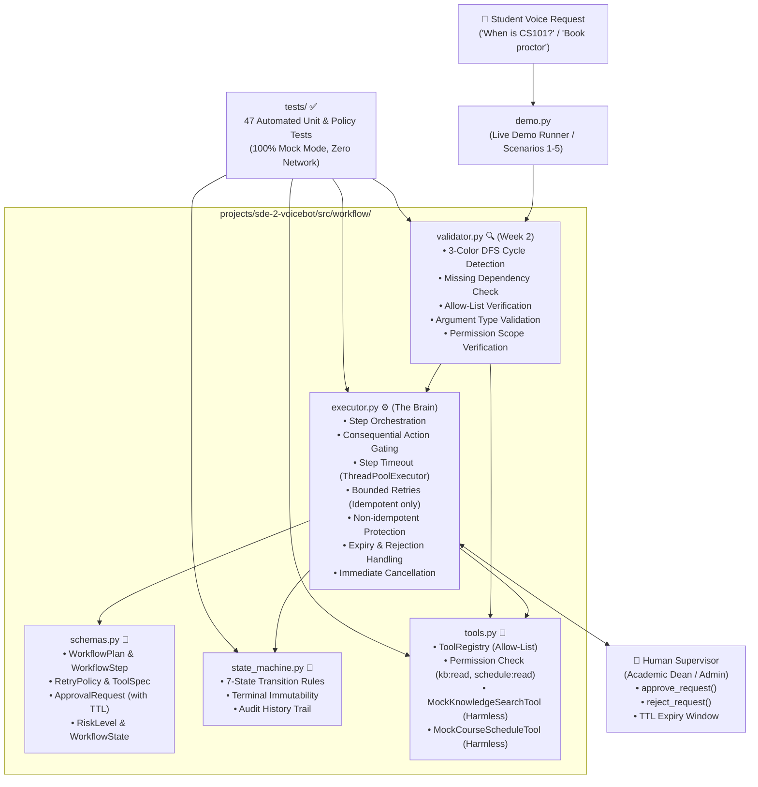
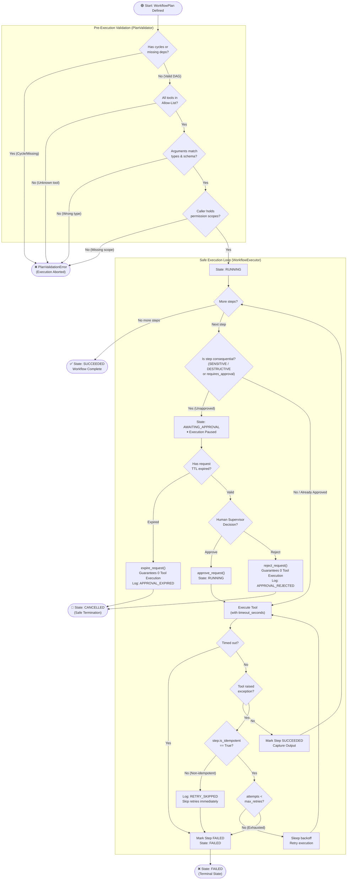
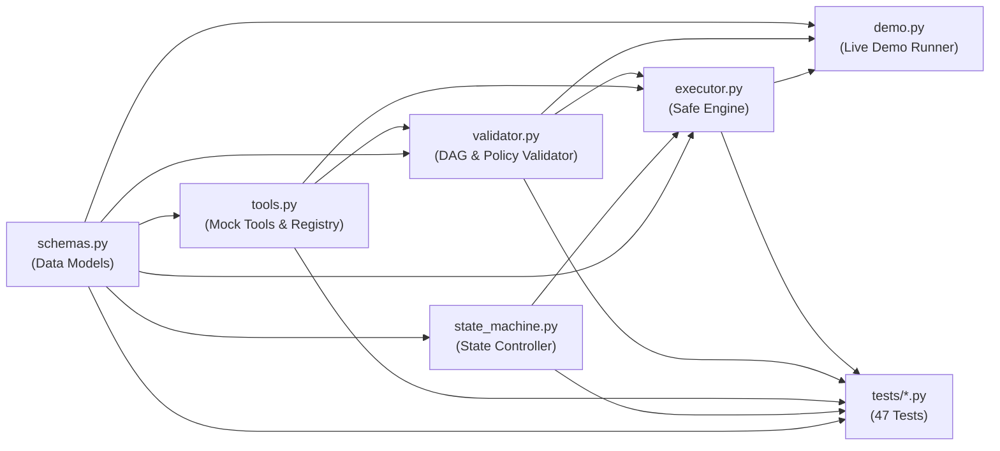

# 🤖 Voicebot SDE-2 — Agentic Workflow Engine: Complete Project Explanation (Week 1 & Week 2)

> **Contributor:** Karthik N M | **Workstream:** W4 — Agentic Workflow Engine | **Scope:** Week 1 (Days 1–7) & Week 2 (Days 8–14) | **Branch:** `team/sde-2-voicebot`

---

## 🎯 What Is This Project?

This project is the **Agentic Workflow Engine** for **Academiaai**, an AI Voice Co-Pilot designed for universities. When a student talks to the voicebot (e.g., asking *"When is my CS101 class?"*, *"What is the tuition fee policy?"*, or *"Can you reschedule my exam proctor?"*), the system does not randomly run code.

Instead, it constructs a structured **`WorkflowPlan`** (a Directed Acyclic Graph or DAG of tasks) and executes it safely.

### The Core Problem This Solves
In an agentic AI system, AI models can produce hallucinations, circular tasks, or attempt dangerous actions (like unauthorized database edits or deleting records). 

**Your Workstream (W4) builds the safety, validation, and execution backbone:**
1. **Validates plans** before execution (rejects circular dependencies, missing steps, unknown tools, and invalid argument types).
2. **Restricts tools** strictly to an allow-list with permission scopes (`kb:read`, `schedule:read`).
3. **Enforces human-in-the-loop approvals** with TTL-based expiration for sensitive/destructive actions.
4. **Executes safely** with per-step timeouts, bounded retries (strictly for idempotent calls), non-idempotent safety, and immediate cancellation.

---

## 📅 Day-by-Day Development Timeline (Days 1–14)

### 🔹 Week 1: Foundation & First Vertical Slice (Days 1–7)
- **Days 1–2 (Schemas & State Machine):**
  - Created typed Pydantic models in `src/workflow/schemas.py`: `WorkflowPlan`, `WorkflowStep`, `ToolSpec`, `ApprovalRequest`, `WorkflowResult`.
  - Built the 7-state deterministic lifecycle controller in `src/workflow/state_machine.py` (`DRAFT`, `AWAITING_APPROVAL`, `RUNNING`, `PAUSED`, `SUCCEEDED`, `FAILED`, `CANCELLED`).
  - Added automatic risk escalation: any `SENSITIVE` or `DESTRUCTIVE` step defaults to `requires_approval = True`.
- **Days 3–4 (Mock Tools & Executor):**
  - Built two harmless mock tools in `src/workflow/tools.py` (`knowledge_search` and `course_schedule`) and the allow-listed `ToolRegistry`.
  - Built the initial `WorkflowExecutor` in `src/workflow/executor.py` with human-in-the-loop approval gating.
- **Days 5–6 (Test Suite):**
  - Authored 35 unit tests validating schemas, transitions, dependency checks, and mock execution.
- **Day 7 (Demonstration):**
  - Created `demo.py` showcasing harmless, approved, and rejected execution flows.

---

### 🔹 Week 2: Safe Execution & Policy Hardening (Days 8–14)
- **Days 8–9 (Plan Validator & Tool Scopes):**
  - Created `src/workflow/validator.py` with a dedicated `PlanValidator`. Implemented a 3-color Depth-First Search (`DFS`) algorithm that detects direct loops ($A \rightarrow B \rightarrow A$) and indirect cycles ($A \rightarrow B \rightarrow C \rightarrow A$) with clear cycle path error reporting.
  - Enhanced `src/workflow/tools.py` with strict argument type validation against JSON schemas and permission scope checks (`check_permissions`).
- **Days 10–11 (Approval Logic with TTL & Expiry):**
  - Upgraded `ApprovalRequest` in `src/workflow/schemas.py` with `ttl_seconds`, auto-calculated `expires_at`, and `is_expired()` checks.
  - Added strict zero-execution guarantees in `src/workflow/executor.py`: if an approval request is rejected OR its TTL expires, the engine guarantees **zero** tool execution, marks steps `CANCELLED`, transitions to `CANCELLED`, and logs structured audit events (`APPROVAL_REJECTED`, `APPROVAL_EXPIRED`). Late approvals on expired requests are refused.
- **Days 12–13 (Timeouts, Bounded Retries & Cancellation):**
  - Added `RetryPolicy`, `timeout_seconds`, and `is_idempotent` to `WorkflowStep` in `src/workflow/schemas.py`.
  - Enforced per-step timeouts in `src/workflow/executor.py` via `ThreadPoolExecutor` (raises `TimeoutError` when breached).
  - Bounded retries: **only** attempted if `step.is_idempotent == True`.
  - Non-idempotent protection: steps with `is_idempotent == False` immediately skip retries (`RETRY_SKIPPED`) to prevent duplicate state mutations.
  - Built immediate workflow cancellation (`cancel()`) that aborts running/pending tasks.
- **Day 14 (Policy Tests & PR Demo):**
  - Added 12 new policy tests in `tests/test_week2_policy_and_safe_executor.py`, bringing the total test suite to **47 passing tests**.
  - Upgraded `demo.py` to showcase all 5 execution scenarios.

---

## 🏗️ System Architecture Diagram



---

## 🔄 End-to-End Workflow Execution Flow



---

## 📂 File-by-File Deep Explanation

---

### 1️⃣ `src/workflow/schemas.py` — The Reusable Blueprints

**Purpose:** Defines all typed data structures and invariants using Pydantic. Reused from Week 1 and cleanly extended in Week 2 without duplicate definitions.

| Model / Enum | What It Does | Key Fields & Logic |
| :--- | :--- | :--- |
| `WorkflowState` *(Enum)* | 7 lifecycle states | `DRAFT`, `AWAITING_APPROVAL`, `RUNNING`, `PAUSED`, `SUCCEEDED`, `FAILED`, `CANCELLED` |
| `RiskLevel` *(Enum)* | 4 safety classifications | `INFORMATIONAL`, `LOW_RISK`, `SENSITIVE`, `DESTRUCTIVE` |
| `ApprovalStatus` *(Enum)* | Status of approval request | `PENDING`, `APPROVED`, `REJECTED`, `EXPIRED` |
| `ToolFailureBehavior` *(Enum)* | Action on tool failure | `FAIL_WORKFLOW`, `RETRY`, `IGNORE_AND_CONTINUE` |
| `ToolSpec` *(Model)* | Tool contract specification | `name`, `purpose`, `input_schema`, `output_schema`, `permission_requirements`, `risk_level` |
| `RetryPolicy` *(Model - W2)* | Bounded retry specification | `max_retries` (0–10), `backoff_seconds`, `retry_on_exceptions` |
| `WorkflowStep` *(Model)* | Single step in execution plan | `step_id`, `tool_name`, `arguments`, `risk_level`, `requires_approval`, `depends_on`, `status`, `timeout_seconds`, `retry_policy`, `is_idempotent` |
| `ApprovalRequest` *(Model)* | Request raised for risky actions | `approval_id`, `plan_id`, `step_id`, `tool_name`, `risk_level`, `action_summary`, `target_resources`, `ttl_seconds`, `expires_at`, `status` |
| `WorkflowPlan` *(Model)* | Complete multi-step plan | `plan_id`, `session_id`, `correlation_id`, `title`, `steps`, `state` |
| `WorkflowResult` *(Model)* | Final execution summary report | `plan_id`, `final_state`, `step_results`, `started_at`, `completed_at`, `error_details` |

#### Key Safety Logic inside `schemas.py`:
1. **Automatic Consequential Escalation:**
   ```python
   @model_validator(mode="after")
   def enforce_consequential_approval_rule(self):
       if self.risk_level in (RiskLevel.SENSITIVE, RiskLevel.DESTRUCTIVE):
           self.requires_approval = True  # Impossible to bypass!
       return self
   ```
2. **TTL Auto-Calculation & Expiration Check:**
   ```python
   @model_validator(mode="after")
   def calculate_expiration(self):
       if self.ttl_seconds is not None and self.expires_at is None:
           self.expires_at = self.created_at + timedelta(seconds=self.ttl_seconds)
       return self

   def is_expired(self, current_time=None) -> bool:
       if self.status == ApprovalStatus.EXPIRED:
           return True
       if self.expires_at is None:
           return False
       now = current_time or datetime.now(timezone.utc)
       return now > self.expires_at
   ```

---

### 2️⃣ `src/workflow/validator.py` — Plan Validation & DAG Integrity (Week 2)

**Purpose:** Validates plans before runtime. Detects circular dependencies, missing steps, unapproved tools, invalid argument types, and permission mismatches.

| Method | What It Validates | Error Raised on Failure |
| :--- | :--- | :--- |
| `validate_dependencies_and_cycles()` | • Duplicate `step_id`<br>• Step depending on missing `step_id`<br>• Self-dependencies<br>• Dependency cycles using 3-color DFS | `PlanValidationError` with full cycle path (e.g. `a -> b -> a`) |
| `validate_tools_and_arguments()` | • Tool exists in allow-list registry<br>• Argument schema & types (checks string, integer, boolean, object, array) | `PlanValidationError` specifying tool name and argument type violation |
| `validate_permission_scopes()` | • Checks if caller permissions contain all `tool.spec.permission_requirements` | `PlanValidationError` detailing missing scopes |
| `validate_plan()` | Runs all 3 validation phases in sequence | `PlanValidationError` |

---

### 3️⃣ `src/workflow/state_machine.py` — The Lifecycle Controller

**Purpose:** Enforces legal state transitions and records an immutable audit history of every transition.

**Allowed State Transitions:**
- `DRAFT` $\rightarrow$ `AWAITING_APPROVAL`, `RUNNING`, `CANCELLED`
- `AWAITING_APPROVAL` $\rightarrow$ `RUNNING`, `CANCELLED`, `FAILED`
- `RUNNING` $\rightarrow$ `PAUSED`, `AWAITING_APPROVAL`, `SUCCEEDED`, `FAILED`, `CANCELLED`
- `PAUSED` $\rightarrow$ `RUNNING`, `CANCELLED`
- **Terminal States (`SUCCEEDED`, `FAILED`, `CANCELLED`):** No transitions out. Once terminal, state is permanently locked.

---

### 4️⃣ `src/workflow/tools.py` — Allow-Listed Tools & Registry

**Purpose:** Provides harmless, in-memory mock tools with **no external network access or computer control**, plus the allow-listed `ToolRegistry`.

| Component | Risk Level | Required Permission | Purpose & Behavior |
| :--- | :--- | :--- | :--- |
| `MockKnowledgeSearchTool` | `INFORMATIONAL` | `kb:read` | Searches academic FAQ, registration deadlines, and CS101 syllabus in an in-memory corpus. Harmless read-only. |
| `MockCourseScheduleTool` | `INFORMATIONAL` | `schedule:read` | Queries course timetables, rooms, and professors (Dr. Alan Turing, Dr. Katherine Johnson, Dr. Richard Feynman). Harmless read-only. |
| `ToolRegistry` | N/A | Enforced | Maintains an allow-list map of `{tool_name: BaseTool}`. Unknown tools raise `KeyError`. Provides `validate_tool_call()` and `execute()`. |

**Week 2 Enhancements in `tools.py`:**
- `validate_arguments()`: Type-checks every argument against `input_schema["properties"]`.
- `check_permissions()`: Verifies that caller holds necessary permission scopes.

---

### 5️⃣ `src/workflow/executor.py` — The Safe Execution Brain

**Purpose:** The central orchestrator that runs the plan steps, gates consequential actions, enforces timeouts, handles retries, and manages approvals.

#### Key Week 2 Capabilities:
1. **Consequential Action Gating:**
   - Any step with `SENSITIVE` or `DESTRUCTIVE` risk pauses execution, creates an `ApprovalRequest` with TTL, and transitions state to `AWAITING_APPROVAL`.
2. **Rejection & Expiry Guarantees Zero Execution:**
   - `reject_request()`: Marks request `REJECTED`, cancels the step and downstream steps, transitions to `CANCELLED`, and logs `APPROVAL_REJECTED`.
   - `expire_request()`: Triggered when TTL is breached. Marks request `EXPIRED`, cancels the step and downstream steps, transitions to `CANCELLED`, and logs `APPROVAL_EXPIRED`.
   - `approve_request()`: If called on an expired request, refuses approval and expires the workflow immediately.
3. **Execution Timeouts:**
   - `_execute_step_with_timeout_and_retries()` wraps tool execution in a `ThreadPoolExecutor`. If elapsed time exceeds `step.timeout_seconds`, it terminates the wait and raises `TimeoutError`.
4. **Bounded Retries strictly for Idempotent Calls:**
   - If `step.is_idempotent == True` and `step.retry_policy` is defined, failures retry up to `max_retries` with `backoff_seconds`.
   - If `step.is_idempotent == False`, retries are **strictly prohibited** even if `retry_policy` is present. It logs `RETRY_SKIPPED` and fails the step immediately to protect against duplicate side effects.
5. **Immediate Cancellation:**
   - `cancel()` cancels all pending and running steps and moves to `CANCELLED`.

---

### 6️⃣ `demo.py` — Live Demonstration (5 Scenarios)

Demonstrates the entire engine working end-to-end:
1. **Scenario 1 (Harmless Automated Workflow):** Runs `knowledge_search` $\rightarrow$ `course_schedule` automatically to `SUCCEEDED`.
2. **Scenario 2 (Consequential with Approval):** Pauses for approval on restricted exam access, human approves, resumes to `SUCCEEDED`.
3. **Scenario 3 (Consequential with Rejection):** Supervisor rejects unauthorized schedule modification $\rightarrow$ guarantees **zero** tool execution, transitions to `CANCELLED`.
4. **Scenario 4 (Consequential with TTL Expiration):** Time expires without human action $\rightarrow$ guarantees **zero** tool execution, transitions to `CANCELLED`.
5. **Scenario 5 (Plan Validator Interception):** Detects dependency cycles ($a \rightarrow b \rightarrow a$) and rejects unsafe plans before execution.

---

### 7️⃣ `tests/` — Automated Test Suite (47 Tests)

| Test File | Description | # Tests |
| :--- | :--- | :---: |
| `test_workflow_schemas_and_sm.py` | Validates Pydantic models, auto-approval escalation, and state machine happy/unhappy transitions. | 13 |
| `test_invalid_plans_and_transitions.py` | Validates cycles, self-dependency, duplicate IDs, missing deps, and transition matrix rules. | 12 |
| `test_mock_tools_and_executor.py` | Validates harmless mock tools, tool registry, approval gating, pause/resume, and unknown tool rejection. | 10 |
| `test_week2_policy_and_safe_executor.py` | **[Week 2]** Validates `PlanValidator`, argument type errors, permission scopes, rejection zero-execution, TTL expiry, timeouts, idempotent retries, non-idempotent protection, and cancellation. | 12 |
| **Total** | **All tests passing in mock mode (0.85s)** | **47** |

---

## 🔗 How Files Connect to Each Other



| Source File | Imports From | Used For |
| :--- | :--- | :--- |
| `state_machine.py` | `schemas.py` | Uses `WorkflowPlan`, `WorkflowState` |
| `tools.py` | `schemas.py` | Uses `ToolSpec`, `RiskLevel`, `ToolFailureBehavior` |
| `validator.py` | `schemas.py`, `tools.py` | Validates `WorkflowPlan` against `ToolRegistry` |
| `executor.py` | `schemas.py`, `state_machine.py`, `tools.py` | Orchestrates plan execution using state machine and tool registry |
| `demo.py` | `schemas.py`, `executor.py`, `validator.py` | Entry point demonstrating all 5 scenarios |
| `tests/*.py` | All source modules | Tests schemas, state machine, tools, validator, and executor |

---

## 🌟 The Main Files (Priority Order)

1. ⭐⭐⭐ **`executor.py`** — The engine's core. Orchestrates steps, enforces timeouts, controls bounded retries, gates consequential actions, and enforces zero-execution on rejection or expiry.
2. ⭐⭐⭐ **`schemas.py`** — The single source of truth. Defines all data models, states, risk levels, retry policies, and TTL rules.
3. ⭐⭐⭐ **`validator.py`** — The security gatekeeper. Inspects DAGs for cycles, verifies allow-lists, validates argument types, and enforces permission scopes before execution.
4. ⭐⭐ **`state_machine.py`** — The lifecycle controller. Enforces strict legal transitions and maintains an immutable audit trail.
5. ⭐⭐ **`tools.py`** — The safe execution environment. Contains harmless mock tools and the allow-listed registry.
6. ⭐ **`demo.py`** — Proves end-to-end functionality across all 5 operational scenarios.
7. ⭐ **`tests/`** — Guarantees correctness through 47 passing tests.

---

## 💻 Commands to Verify

```bash
# 1. Run all 47 automated tests
cd projects/sde-2-voicebot
python -m pytest tests -v

# 2. Run the 5-scenario live demonstration
python demo.py
```

