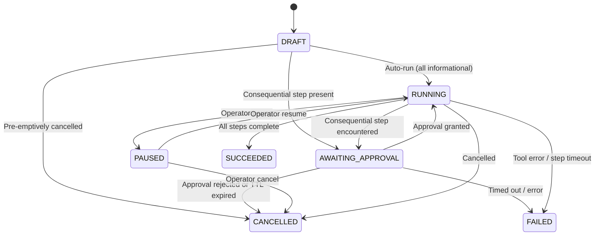

# Workstream W4: Agentic Workflow Engine (Week 1 & Week 2)

**Student:** Karthik N M  
**Team:** SDE 2 (`projects/sde-2-voicebot/`)  
**Scope:** Days 1–14 (Plan Validation, Allow-Listed Tool Registry, Approval Logic & Safe Executor)

---

## 1. Executive Summary

This repository delivers the complete foundation and safe execution engine for the Academiaai Voicebot, strictly adhering to the requirements of Workstream W4 across Weeks 1 & 2:

### Week 1 (Days 1–7): Foundation & First Vertical Slice
1. **Typed Workflow Schemas (Days 1–2):** Single-source schemas defined in `src/workflow/schemas.py` (`WorkflowPlan`, `WorkflowStep`, `ToolSpec`, `ApprovalRequest`, `WorkflowResult`).
2. **Deterministic State Machine (Days 1–2):** Enforces lifecycle transitions (`draft`, `awaiting_approval`, `running`, `paused`, `succeeded`, `failed`, `cancelled`) with full audit history in `src/workflow/state_machine.py`.
3. **Mock Tools (Days 3–4):** Implements two harmless mock tools (`MockKnowledgeSearchTool`, `MockCourseScheduleTool`) with no external sending, and safe `ToolRegistry` in `src/workflow/tools.py`.
4. **Agentic Executor (Days 3–4):** Orchestrates step execution in mock mode with a mandatory safety gate where sensitive/destructive actions automatically default to awaiting human approval in `src/workflow/executor.py`.

### Week 2 (Days 8–14): Safe Execution Upgrade
1. **Plan Validator (Days 8–9):** `PlanValidator` in `src/workflow/validator.py` detects dependency cycles (DFS), missing dependencies, duplicate IDs, unknown tools, argument types, and enforces permission scopes.
2. **Approval Logic & Expiry (Days 10–11):** `ApprovalRequest` includes TTL (`ttl_seconds`, `expires_at`). Rejection or expiration strictly guarantees ZERO tool execution and logs safe audit events.
3. **Safe Executor (Days 12–13):** `WorkflowExecutor` enforces step timeouts, bounded retries strictly for idempotent steps (`is_idempotent=True`), non-idempotent safety, and immediate cancellation.
4. **Policy Tests & Live Demonstration (Day 14):** 47 automated tests in `tests/` and live demonstration in `demo.py` covering approved, rejected, expired, and invalid plans.

---

## 2. Architecture & Component Structure

```
projects/sde-2-voicebot/
│
├── demo.py                                     # Live execution demonstration (Scenarios 1-5)
├── src/
│   ├── __init__.py
│   └── workflow/
│       ├── __init__.py                         # Package exports
│       ├── schemas.py                          # Pydantic schemas (W1 & W2: RetryPolicy, TTL, timeouts)
│       ├── state_machine.py                    # State machine & transition rules
│       ├── validator.py                        # PlanValidator: cycles, deps, allow-list, scopes (W2)
│       ├── tools.py                            # Harmless mock tools, registry & permissions (W2)
│       ├── executor.py                         # Safe executor: timeouts, retries, expiry (W2)
│       └── README.md                           # Documentation & test report
└── tests/
    ├── __init__.py
    ├── test_workflow_schemas_and_sm.py         # Schema & basic SM tests
    ├── test_invalid_plans_and_transitions.py   # Invalid plans & transition matrix
    ├── test_mock_tools_and_executor.py         # Mock tools & executor tests
    └── test_week2_policy_and_safe_executor.py  # Week 2 Policy, Validator, Expiry & Retries (W2)
```

---

## 3. Schemas Specification (`src/workflow/schemas.py`)

| Schema | Purpose | Key Attributes |
| :--- | :--- | :--- |
| `ToolSpec` | Declares allow-listed tools | `name`, `purpose`, `input_schema`, `output_schema`, `permission_requirements`, `risk_level`, `failure_behavior` |
| `RetryPolicy` | Bounded retry specification | `max_retries`, `backoff_seconds`, `retry_on_exceptions` |
| `WorkflowStep` | Atomic executable action | `step_id`, `tool_name`, `arguments`, `risk_level`, `requires_approval`, `depends_on`, `status`, `timeout_seconds`, `retry_policy`, `is_idempotent` |
| `ApprovalRequest` | Human-in-the-loop permission request | `approval_id`, `plan_id`, `step_id`, `tool_name`, `risk_level`, `action_summary`, `ttl_seconds`, `expires_at`, `status` |
| `WorkflowPlan` | Multi-step execution DAG | `plan_id`, `session_id`, `correlation_id`, `title`, `steps`, `state`, `schema_version` |
| `WorkflowResult` | Final terminal execution report | `plan_id`, `session_id`, `final_state`, `step_results`, `started_at`, `completed_at`, `error_details` |

### Safety Invariants
1. **Automatic Consequential Escalation:** Any step with `RiskLevel.SENSITIVE` or `RiskLevel.DESTRUCTIVE` is automatically coerced to `requires_approval = True`.
2. **Non-Idempotent Protection:** Steps with `is_idempotent = False` are strictly protected against retries, even if a retry policy is specified.
3. **Approval Expiry:** Requests exceeding TTL are marked `EXPIRED`, guaranteeing zero downstream tool execution.

---

## 4. State Machine Transition Matrix (`src/workflow/state_machine.py`)



---

## 5. Week 2 Acceptance Criteria Validation

| Requirement | Implementation | Validation Test |
| :--- | :--- | :--- |
| **Cycles & missing dependencies rejected** | `PlanValidator.validate_dependencies_and_cycles` uses 3-color DFS | `test_validator_rejects_missing_dependency`, `test_validator_rejects_cycles_with_clear_error` |
| **Unknown tools & invalid args rejected** | `ToolRegistry.validate_tool_call` checks allow-list and argument types | `test_validator_rejects_unknown_tool`, `test_validator_rejects_invalid_argument_types` |
| **Permission scopes enforced** | `BaseTool.check_permissions` validates against caller scopes | `test_validator_enforces_permission_scopes` |
| **Rejection guarantees no execution** | `WorkflowExecutor.reject_request` cancels step & downstream DAG | `test_approval_rejection_guarantees_no_execution_and_audit_event` |
| **Expiry guarantees no execution** | `WorkflowExecutor.expire_request` verifies TTL and cancels step | `test_approval_expiry_guarantees_no_execution_and_audit_event`, `test_approving_expired_request_refuses_execution` |
| **Executor timeouts enforced** | ThreadPoolExecutor with timeout raises `TimeoutError` | `test_executor_enforces_step_timeout` |
| **Bounded retries only for idempotent calls** | `_execute_step_with_timeout_and_retries` checks `step.is_idempotent` | `test_bounded_retries_for_idempotent_step`, `test_retries_strictly_prohibited_for_non_idempotent_step` |
| **Cancellation works** | `WorkflowExecutor.cancel` immediately halts all active/pending steps | `test_executor_cancellation_halts_workflow_safely` |
| **Harmless mock tools** | `knowledge_search` and `course_schedule` operate on local in-memory data | `test_mock_tools_harmless_and_consequential_behavior` |

---

## 6. Running Tests & Live Demonstration

### Running Unit & Policy Tests (47 Tests Passing):
```bash
cd projects/sde-2-voicebot
python -m pytest tests -v
```

### Running Live Demonstration:
```bash
python projects/sde-2-voicebot/demo.py
```
Demonstrates:
- **Scenario 1:** Harmless automated workflow (SUCCEEDED)
- **Scenario 2:** Consequential action with approval granted (SUCCEEDED)
- **Scenario 3:** Consequential action with rejection (CANCELLED, zero tool execution)
- **Scenario 4:** Consequential action with approval TTL expiry (CANCELLED, zero tool execution)
- **Scenario 5:** Plan validation cycle detection before execution
