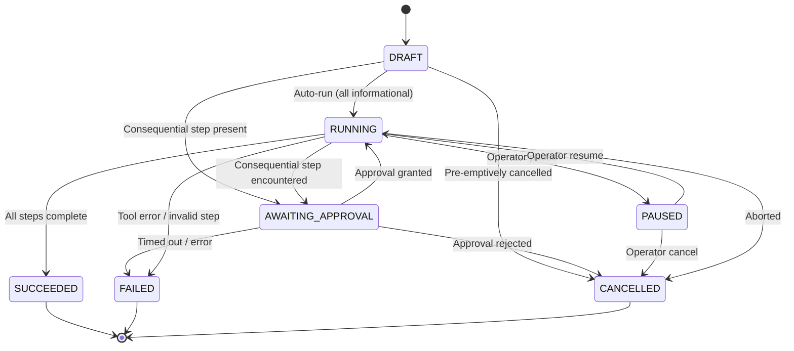

# Workstream W4: Agentic Workflow Engine (Days 1–7)

**Student:** Karthik N M  
**Team:** SDE 2 (`projects/sde-2-voicebot/`)  
**Scope:** Week 1 — Foundation and First Vertical Slice (Days 1–7)

---

## 1. Executive Summary

This repository delivers the complete foundation and vertical slice of the agentic workflow engine for the Academiaai Voicebot, strictly adhering to the requirements of Workstream W4 (Days 1–7):

1. **Typed Workflow Schemas (Days 1–2):** Single-source schemas defined in `src/workflow/schemas.py` (`WorkflowPlan`, `WorkflowStep`, `ToolSpec`, `ApprovalRequest`, `WorkflowResult`).
2. **Deterministic State Machine (Days 1–2):** Enforces lifecycle transitions (`draft`, `awaiting_approval`, `running`, `paused`, `succeeded`, `failed`, `cancelled`) with full audit history in `src/workflow/state_machine.py`.
3. **Mock Tools (Days 3–4):** Implements two harmless mock tools (`MockKnowledgeSearchTool`, `MockCourseScheduleTool`) with no external sending, and a safe `ToolRegistry` in `src/workflow/tools.py`.
4. **Agentic Executor (Days 3–4):** Orchestrates step execution in mock mode with a mandatory safety gate where sensitive/destructive actions automatically default to awaiting human approval in `src/workflow/executor.py`.
5. **Comprehensive Tests (Days 5–6):** 35 unit tests validating invalid plans (cycles, missing dependencies, duplicate IDs), illegal and legal state transitions, and executor behavior in `tests/`.
6. **Live Demonstration & PR (Day 7):** Runnable demonstration script (`demo.py`) executing all execution paths from start to finish.

---

## 2. Architecture & Component Structure

```
projects/sde-2-voicebot/
│
├── demo.py                                     # Day 7 live execution demonstration
├── src/
│   ├── __init__.py
│   └── workflow/
│       ├── __init__.py                         # Package exports
│       ├── schemas.py                          # Pydantic schemas (D1-2)
│       ├── state_machine.py                    # State machine & transition rules (D1-2)
│       ├── tools.py                            # Two harmless mock tools & ToolRegistry (D3-4)
│       ├── executor.py                         # Agentic execution engine (D3-4)
│       └── README.md                           # Documentation & test report
└── tests/
    ├── __init__.py
    ├── test_workflow_schemas_and_sm.py         # Schema & basic SM tests
    ├── test_invalid_plans_and_transitions.py   # Invalid plans & transition matrix (D5-6)
    └── test_mock_tools_and_executor.py         # Mock tools & executor tests (D5-6)
```

---

## 3. Schemas Specification (`src/workflow/schemas.py`)

| Schema | Purpose | Key Attributes |
| :--- | :--- | :--- |
| `ToolSpec` | Declares allow-listed tools | `name`, `purpose`, `input_schema`, `output_schema`, `permission_requirements`, `risk_level`, `failure_behavior` |
| `WorkflowStep` | Atomic executable action | `step_id`, `tool_name`, `arguments`, `description`, `risk_level`, `requires_approval`, `depends_on`, `status`, `result` |
| `ApprovalRequest` | Human-in-the-loop permission request | `approval_id`, `session_id`, `correlation_id`, `plan_id`, `step_id`, `tool_name`, `risk_level`, `action_summary`, `target_resources`, `status` |
| `WorkflowPlan` | Multi-step execution DAG | `plan_id`, `session_id`, `correlation_id`, `title`, `steps`, `state`, `schema_version`, `metadata` |
| `WorkflowResult` | Final terminal execution report | `plan_id`, `session_id`, `correlation_id`, `final_state`, `step_results`, `started_at`, `completed_at`, `error_details` |

### Safety Invariant
In `WorkflowStep`, any step classified with `RiskLevel.SENSITIVE` or `RiskLevel.DESTRUCTIVE` is automatically coerced to `requires_approval = True` by model validation.

---

## 4. State Machine Transition Matrix (`src/workflow/state_machine.py`)



---

## 5. Mock Tools & Executor (`src/workflow/tools.py` & `src/workflow/executor.py`)

The workflow engine includes **two harmless mock tools** with **no external sending** (safe, sandboxed, deterministic execution):

### 1. `MockKnowledgeSearchTool` (Harmless)
* **Tool Name:** `knowledge_search`
* **Risk Level:** `INFORMATIONAL`
* **Purpose:** Semantic query across course catalog, schedule, and institutional policies.
* **Execution:** Returns matching knowledge items without state mutations or external dispatch.

### 2. `MockCourseScheduleTool` (Harmless)
* **Tool Name:** `course_schedule`
* **Risk Level:** `INFORMATIONAL`
* **Purpose:** Retrieves class timetables, lecture locations, professor office hours, and recitation times for courses.
* **Execution:** Safely queries local mock schedule data with no external sending.

---

## 6. Test Suite & Validation Results (Days 5–6)

Run test suite:
```bash
python -m pytest tests -v
```

### Passing Output (35 Tests Passing):
```
tests/test_invalid_plans_and_transitions.py::test_invalid_plan_empty_title PASSED          [  2%]
tests/test_invalid_plans_and_transitions.py::test_invalid_plan_direct_cycle PASSED        [  5%]
tests/test_invalid_plans_and_transitions.py::test_invalid_plan_multi_step_cycle PASSED    [  8%]
tests/test_invalid_plans_and_transitions.py::test_invalid_plan_missing_tool_name PASSED   [ 11%]
tests/test_invalid_plans_and_transitions.py::test_invalid_plan_non_existent_dependency PASSED [ 14%]
tests/test_invalid_plans_and_transitions.py::test_invalid_plan_self_dependency PASSED     [ 17%]
tests/test_invalid_plans_and_transitions.py::test_invalid_plan_duplicate_step_ids PASSED  [ 20%]
tests/test_invalid_plans_and_transitions.py::test_state_machine_all_legal_transitions PASSED [ 22%]
tests/test_invalid_plans_and_transitions.py::test_state_machine_illegal_draft_transitions PASSED [ 25%]
tests/test_invalid_plans_and_transitions.py::test_state_machine_illegal_awaiting_approval_transitions PASSED [ 28%]
tests/test_invalid_plans_and_transitions.py::test_state_machine_terminal_states_immutable PASSED [ 31%]
tests/test_invalid_plans_and_transitions.py::test_state_machine_audit_trail_logging PASSED [ 34%]
tests/test_mock_tools_and_executor.py::test_mock_knowledge_search_tool_happy_path PASSED  [ 37%]
tests/test_mock_tools_and_executor.py::test_mock_knowledge_search_tool_missing_arg_raises PASSED [ 40%]
tests/test_mock_tools_and_executor.py::test_mock_course_schedule_tool_happy_path PASSED   [ 42%]
tests/test_mock_tools_and_executor.py::test_mock_course_schedule_tool_missing_arg_raises PASSED [ 45%]
tests/test_mock_tools_and_executor.py::test_mock_tools_harmless_and_consequential_behavior PASSED [ 48%]
tests/test_mock_tools_and_executor.py::test_tool_registry PASSED                           [ 51%]
tests/test_mock_tools_and_executor.py::test_executor_harmless_workflow_runs_to_succeeded PASSED [ 54%]
tests/test_mock_tools_and_executor.py::test_executor_consequential_action_pauses_for_approval PASSED [ 57%]
tests/test_mock_tools_and_executor.py::test_executor_consequential_action_rejected_cancels_workflow PASSED [ 60%]
tests/test_mock_tools_and_executor.py::test_executor_pause_and_resume PASSED              [ 62%]
tests/test_mock_tools_and_executor.py::test_executor_unregistered_tool_fails_workflow PASSED [ 65%]
tests/test_workflow_schemas_and_sm.py::test_tool_spec_creation_valid PASSED               [ 68%]
tests/test_workflow_schemas_and_sm.py::test_tool_spec_empty_name_fails PASSED             [ 71%]
tests/test_workflow_schemas_and_sm.py::test_workflow_step_consequential_auto_approval PASSED [ 74%]
tests/test_workflow_schemas_and_sm.py::test_workflow_plan_valid PASSED                     [ 77%]
tests/test_workflow_schemas_and_sm.py::test_workflow_plan_duplicate_step_id_rejected PASSED [ 80%]
tests/test_workflow_schemas_and_sm.py::test_workflow_plan_non_existent_dependency_rejected PASSED [ 82%]
tests/test_workflow_schemas_and_sm.py::test_workflow_plan_self_dependency_rejected PASSED [ 85%]
tests/test_workflow_schemas_and_sm.py::test_approval_request_model PASSED                 [ 88%]
tests/test_workflow_schemas_and_sm.py::test_workflow_result_model PASSED                   [ 91%]
tests/test_workflow_schemas_and_sm.py::test_state_machine_happy_path PASSED                [ 94%]
tests/test_workflow_schemas_and_sm.py::test_state_machine_approval_and_rejection PASSED   [ 97%]
tests/test_workflow_schemas_and_sm.py::test_state_machine_invalid_transition_raises PASSED [100%]

============================= 35 passed in 0.71s ==============================
```

---

## 7. Day 7 Demonstration Walkthrough

Run the live demo script:
```bash
python projects/sde-2-voicebot/demo.py
```

### Demonstrated Execution Scenarios:
1. **Scenario 1 (Harmless Automated Plan):**
   * Steps: `knowledge_search` -> `course_schedule`.
   * Transitions: `draft` -> `running` -> `succeeded`.
2. **Scenario 2 (Consequential Plan with Approval Granted):**
   * Steps: `knowledge_search` -> `course_schedule` (Access restricted exam schedule: Sensitive).
   * Transitions: `draft` -> `running` -> `awaiting_approval` -> (Approval Granted) -> `running` -> `succeeded`.
3. **Scenario 3 (Consequential Plan with Approval Rejected):**
   * Steps: `course_schedule` (Unauthorized schedule override: Destructive).
   * Transitions: `draft` -> `running` -> `awaiting_approval` -> (Approval Rejected) -> `cancelled`.
