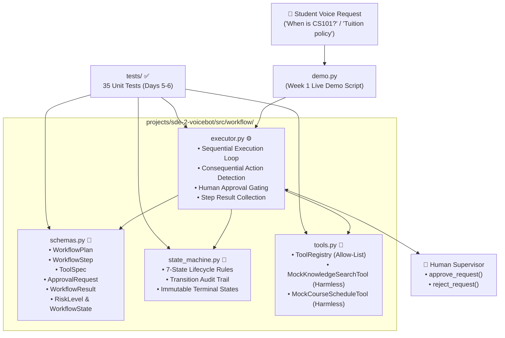
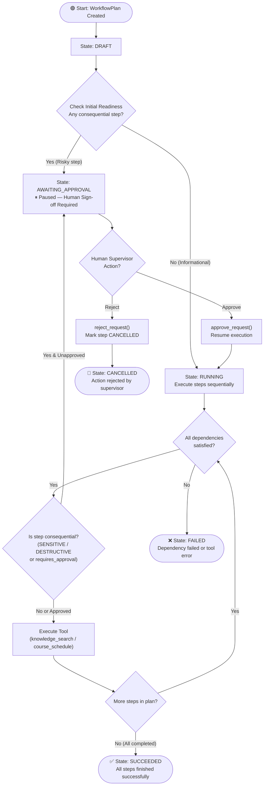
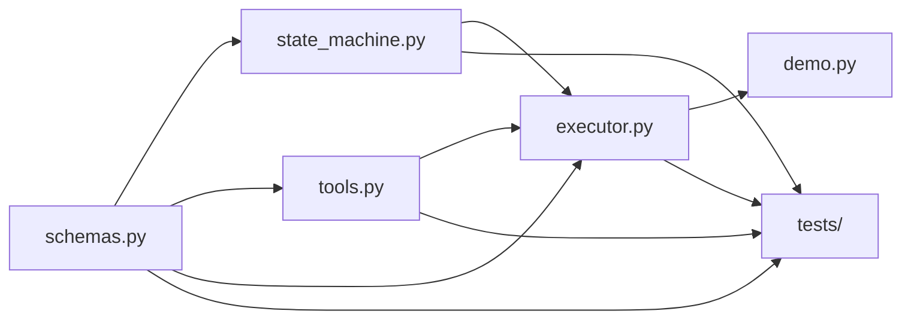

# 🤖 Voicebot SDE-2 — Agentic Workflow Engine: Week 1 Project Explanation

> **Contributor:** Karthik N M | **Workstream:** W4 — Agentic Workflow Engine | **Scope:** Week 1 (Days 1–7) Foundation & First Vertical Slice

---

## 🎯 What Is Week 1 About?

In Week 1, your task was to build the **foundation and first vertical slice** of the **Agentic Workflow Engine** for **Academiaai**, an AI university voicebot.

When a student interacts with the voicebot to query course schedules, academic policies, or attempt actions, the system needs an engine to:
1. Represent the tasks as a structured, typed execution plan (`WorkflowPlan`).
2. Manage execution states using a finite state machine (`WorkflowStateMachine`).
3. Provide safe, read-only mock tools (`MockKnowledgeSearchTool`, `MockCourseScheduleTool`) with zero external dispatch.
4. Enforce **Human-in-the-Loop (HITL) approval gating**: If a task is consequential (`SENSITIVE` or `DESTRUCTIVE`), execution **must halt** and transition to `AWAITING_APPROVAL` until a human explicitly approves or rejects it.

---

## 📅 Week 1 Day-by-Day Deliverables (Days 1–7)

| Days | Phase | What Was Built | Key Files |
| :--- | :--- | :--- | :--- |
| **Days 1–2** | Schemas & State Machine | • Typed Pydantic schemas for plans, steps, tools, and approvals<br>• 7-state deterministic lifecycle controller<br>• Automatic risk escalation (sensitive/destructive $\rightarrow$ `requires_approval = True`) | `schemas.py`<br>`state_machine.py` |
| **Days 3–4** | Mock Tools & Executor | • Two harmless, in-memory mock tools (`knowledge_search`, `course_schedule`)<br>• Allow-listed `ToolRegistry`<br>• `WorkflowExecutor` with approval gating & audit logging | `tools.py`<br>`executor.py` |
| **Days 5–6** | Test Suite | • 35 unit tests covering schemas, invalid plans, legal/illegal transitions, and executor behavior | `tests/` |
| **Day 7** | Live Demonstration | • Interactive demonstration script verifying harmless, approved, and rejected execution flows | `demo.py` |

---

## 🏗️ Week 1 System Architecture Diagram



---

## 🔄 Week 1 Workflow Execution Flow Diagram



---

## 📁 Week 1 File-by-File Deep Explanation

---

### 1️⃣ `src/workflow/schemas.py` — The Foundation Blueprints (Days 1–2)

**Purpose:** Defines all typed data structures and models using Pydantic.

| Class / Model | Description |
| :--- | :--- |
| `WorkflowState` | Enum for the 7 lifecycle states: `draft`, `awaiting_approval`, `running`, `paused`, `succeeded`, `failed`, `cancelled`. |
| `RiskLevel` | Safety tiers: `informational` (Category A), `low_risk` (Category B), `sensitive` (Category C), `destructive` (Category D). |
| `ApprovalStatus` | Status of an approval: `pending`, `approved`, `rejected`, `expired`. |
| `ToolSpec` | Declares tool metadata: name, purpose, input/output schemas, permission requirements, risk level. |
| `WorkflowStep` | An individual action: `step_id`, `tool_name`, `arguments`, `description`, `risk_level`, `requires_approval`, `depends_on`, `status`. |
| `ApprovalRequest` | Generated when a consequential action is paused: stores `approval_id`, `step_id`, `tool_name`, `risk_level`, `action_summary`. |
| `WorkflowPlan` | The full multi-step DAG: holds `plan_id`, `session_id`, `correlation_id`, `title`, `steps`, `state`. |
| `WorkflowResult` | Final execution output: terminal state, execution timestamps, step results, and error details. |

#### Core Safety Invariant:
```python
@model_validator(mode="after")
def enforce_consequential_approval_rule(self):
    """Any sensitive or destructive step automatically requires human approval."""
    if self.risk_level in (RiskLevel.SENSITIVE, RiskLevel.DESTRUCTIVE):
        self.requires_approval = True
    return self
```

---

### 2️⃣ `src/workflow/state_machine.py` — The Lifecycle Controller (Days 1–2)

**Purpose:** Enforces legal state transitions and maintains an audit trail.

**Transition Rules:**
- `DRAFT` $\rightarrow$ `AWAITING_APPROVAL`, `RUNNING`, `CANCELLED`
- `AWAITING_APPROVAL` $\rightarrow$ `RUNNING`, `CANCELLED`, `FAILED`
- `RUNNING` $\rightarrow$ `PAUSED`, `AWAITING_APPROVAL`, `SUCCEEDED`, `FAILED`, `CANCELLED`
- `PAUSED` $\rightarrow$ `RUNNING`, `CANCELLED`
- `SUCCEEDED`, `FAILED`, `CANCELLED` are **immutable terminal states** (no outgoing transitions allowed).

Every transition is recorded as a `StateTransitionEvent` with timestamp, `from_state`, `to_state`, and `reason`.

---

### 3️⃣ `src/workflow/tools.py` — Mock Tools & Tool Registry (Days 3–4)

**Purpose:** Provides two harmless mock tools operating purely on in-memory fixtures (no external network calls, no system commands):

1. **`MockKnowledgeSearchTool` (`knowledge_search`):**
   - Risk: `INFORMATIONAL`
   - Purpose: Queries academic policies, exam guidelines, and CS101 syllabus.
   - Fixture Data: Built-in knowledge corpus (`KB-101` to `KB-104`).
2. **`MockCourseScheduleTool` (`course_schedule`):**
   - Risk: `INFORMATIONAL`
   - Purpose: Returns classroom locations, schedules, and professors (`CS101`, `MATH201`, `PHY101`, `BIO110`).
3. **`ToolRegistry`:**
   - Allow-list registry mapping registered tool names to tool instances.
   - Throws `KeyError` if an unapproved tool is requested.

---

### 4️⃣ `src/workflow/executor.py` — The Execution Engine (Days 3–4)

**Purpose:** Orchestrates the step execution flow:
- Evaluates dependencies (`depends_on`).
- Checks if a step is consequential (`is_step_consequential()`).
- If consequential: pauses execution, generates an `ApprovalRequest`, and sets state to `AWAITING_APPROVAL`.
- `approve_request()`: Marks request approved, returns workflow to `RUNNING`, and resumes execution.
- `reject_request()`: Marks request rejected, cancels the step, transitions workflow to `CANCELLED`, and stops further execution.
- `pause()` and `resume()`: Operator controls to pause/resume in-flight execution.

---

### 5️⃣ `demo.py` — Week 1 Live Demonstration (Day 7)

Runs 3 real scenarios:
- **Scenario 1 (Harmless Automated Plan):** `knowledge_search` $\rightarrow$ `course_schedule` (Runs to `SUCCEEDED` automatically).
- **Scenario 2 (Consequential Plan - Approved):** Sensitive exam proctor timetable request pauses at `AWAITING_APPROVAL`, Academic Dean approves, workflow resumes to `SUCCEEDED`.
- **Scenario 3 (Consequential Plan - Rejected):** Destructive schedule override request pauses, supervisor rejects, workflow halts safely at `CANCELLED`.

---

### 6️⃣ `tests/` — Week 1 Test Suite (Days 5–6)

**35 unit tests** verifying all requirements:
1. `test_workflow_schemas_and_sm.py` (13 tests): Model construction, auto-approval escalation, state machine happy/unhappy paths.
2. `test_mock_tools_and_executor.py` (10 tests): Tool execution, registry lookup, approval gating, pause/resume.
3. `test_invalid_plans_and_transitions.py` (12 tests): Duplicate IDs, missing dependencies, cycles, illegal state transitions.

---

## 🔗 How Week 1 Files Connect



---

## 🌟 Week 1 Main Takeaways

1. **Safety First:** Risky operations cannot run silently. Any step classified as `SENSITIVE` or `DESTRUCTIVE` is forced to await human approval.
2. **Deterministic Lifecycle:** The state machine strictly prevents illegal transitions (e.g. jumping from `DRAFT` directly to `SUCCEEDED`).
3. **Mock Mode Guarantee:** All tools run on local in-memory dictionaries with zero network or computer control risks.
4. **Complete Audit Trail:** Every state change is recorded with timestamps and reasons for compliance and debugging.

