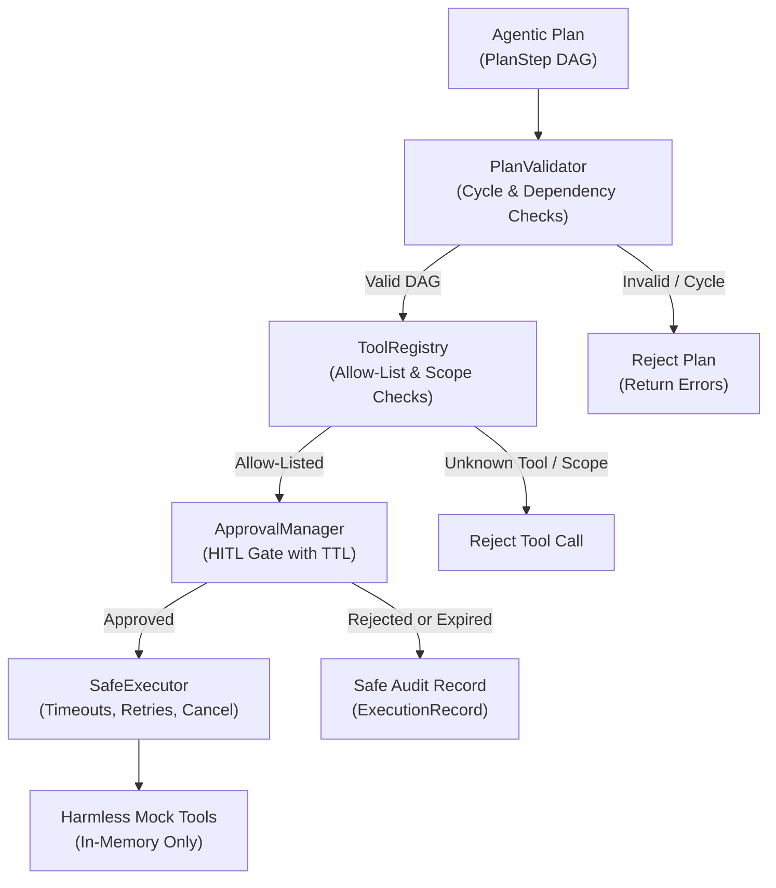

# 🛡️ Voicebot SDE-2 — Agentic Workflow Engine: Week 2 Project Explanation

> **Contributor:** Karthik N M | **Workstream:** W4 — Agentic Workflow Engine | **Scope:** Week 2 (Days 8–14) Plan Validation, Tool Registry, Approval Logic & Safe Executor

---

## 🎯 What Is Week 2 About?

In Week 2, the goal was to make agentic workflows **safe to run in production**:
1. **Plan Validation (Days 8–9):** Ensure execution DAGs cannot execute invalid dependencies or infinite cycles. Validate schemas, argument types, and permission scopes before any tool is scheduled.
2. **Strict Tool Allow-Listing (Days 8–9):** Only approved tools registered in `ToolRegistry` are executable. Unknown tools and unauthorized scopes are rejected up-front.
3. **Approval Lifecycle & Expiry (Days 10–11):** Enforce human sign-off (`approve`, `reject`) with TTL expiration. Rejection or expiry **strictly guarantees ZERO tool execution** and records an immutable safe audit record.
4. **Safe Executor Guarantees (Days 12–13):** Enforce wall-clock timeouts per step, restrict retries **strictly to idempotent operations**, protect non-idempotent operations from unsafe re-runs, and support immediate cooperative thread cancellation.
5. **Policy Tests & Live Demonstration (Day 14):** Comprehensive test suites (55+ tests) and end-to-end demo scripts illustrating approved, rejected, and expired workflow paths.

---

## 📅 Week 2 Day-by-Day Deliverables (Days 8–14)

| Days | Phase | What Was Built | Key Files |
| :--- | :--- | :--- | :--- |
| **Days 8–9** | Plan Validation & Tool Registry | • Dependency and cycle validation (DFS / Kahn's topological sort) • Allow-listed tool registry with strict argument schema & type validation • Permission scope enforcement (`read_files`, `search`, `compute`, `kb:read`, `schedule:read`) | `plan_validator.py` `tool_registry.py` `src/workflow/validator.py` |
| **Days 10–11** | Approval Logic with Expiry | • Approval state lifecycle (`pending`, `approved`, `rejected`, `expired`) • TTL expiry tracking (`ttl_seconds`, `expires_at`, `is_expired()`) • Guaranteed zero-tool-execution on rejection/expiry + safe audit record generation | `approval_manager.py` `src/workflow/executor.py` |
| **Days 12–13** | Safe Executor | • Per-step wall-clock timeouts (`FuturesTimeout` via ThreadPoolExecutor) • Bounded retries strictly for idempotent tools (`idempotent = True`) • Non-idempotent operation protection • Immediate cooperative cancellation (`threading.Event`) | `safe_executor.py` `src/workflow/executor.py` |
| **Day 14** | Policy Tests & Demonstration | • 55 policy tests covering all safety invariants (102 tests total across project) • D14 end-to-end demonstration (`test_demo.py` & `demo.py`) | `tests/` `demo.py` |

---

## 🏗️ Week 2 Safety Workflow Architecture

---

## 🛡️ Core Safety Invariants Enforced

1. **Cycle and Dependency Safety:** Any plan referencing an undeclared step or containing a cycle is halted before scheduling.
2. **Allow-List Isolation:** No tool outside the explicit registry can ever be called. No administrative or arbitrary command execution.
3. **Guaranteed Non-Execution:** If an approval is rejected or its TTL elapses, the executor produces a cancellation audit record without invoking any tool callback.
4. **Idempotency-Bounded Retries:** Only tools flagged as idempotent may be retried. Non-idempotent operations fail immediately on the first error to prevent unintended side effects.
5. **Immediate Cancellation:** If a cancellation event is signaled, in-flight retries and all downstream steps are skipped immediately.

